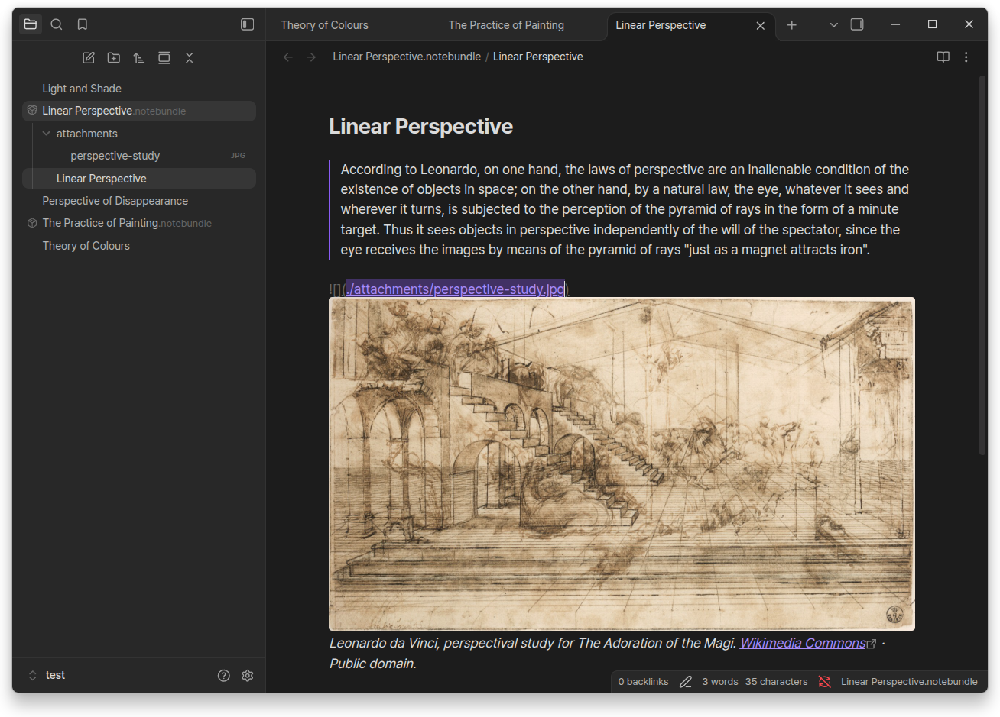
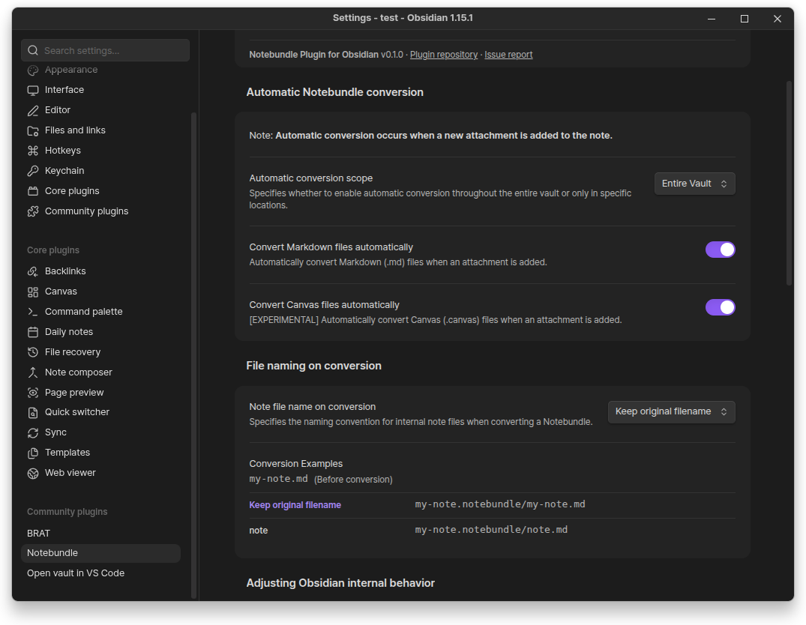

# Notebundle Plugin for Obsidian

Obsidian plugin to support the Notebundle (.notebundle) convention natively.

Tested with Obsidian 1.15.1 (Linux, Android)





## What is Notebundle (.notebundle)

[About Notebundle Convention](https://github.com/leehan273/notebundle)

> A proposal for a simple folder structure and naming convention for managing plain-text notes and their attachments.

**TL;DR:** Notebundle is a file structure and naming convention for managing plain-text notes and their attachments: a single note file bundled together with its attachments in a `.notebundle` folder.

```text
my-note.notebundle/
├── attachments/
│   └── image.png
└── my-note.md
```

For example, when a notebundle is used in a directory that contains multiple note files, the directory will look like this:

```text
notes/
├── just-normal-note.md
├── lorem-ipsum.md
├── MM-DD-research-note.notebundle/
├── my-note.notebundle/
└── todo.md
```

## Usage guide

This plugin is designed to resolve attachment placement issues as automatically as possible, while keeping things structured so that users can easily make manual changes at any time, even when the plugin is disabled.

- Automatic conversion happens when you add a new attachment to a note. To minimize the risk of damaging the contents or structure of other note files, only newly attached files are moved into the bundle during automatic conversion.

    Existing attachments can be collected automatically by running the “Collect attachments into the current notebundle” command.

- Files moved into a bundle automatically (including when using the attachment collection command) are files referenced only by that note.

- When converting to a Notebundle, keep in mind that the existing note will be placed inside a `.notebundle` folder. You may need to update your Bases or Dataview scripts accordingly.

    If the file previously existed only as `Projects/mini-project.md`, after conversion to a notebundle, its actual location could be any of these three:

    - `Projects/mini-project.md`
    - `Projects/mini-project.notebundle/mini-project.md`
    - `Projects/mini-project.notebundle/note.md`

    For example, if your Bases query directly checks only a specific folder, such as `file.folder == "Projects"`, you can change it to `file.inFolder("Projects")` to automatically include subfolders.

- If you use note formats in your vault that aren’t natively supported by Obsidian, such as Typst, add their extensions under "Lab - Excluded attachment extensions from full collection" to prevent unwanted file moves.

- Automatic conversion and collection of files in the current Canvas may fail to detect some files, depending on how they’re referenced, and may not automatically import them into the bundle.

    Also, [references within Canvas files only work with full vault paths under Obsidian’s current behavior.](https://forum.obsidian.md/t/canvas-ignoring-files-and-links-settings/113282/7)
    As a result, they’re less portable than Markdown notebundles with the relative path option enabled.

## Compatibility Notice

WARNING: Since this plugin’s primary function is managing attachments, it is highly likely to conflict with other plugins that automatically manage attachments (such as plugins that automatically rename attachments or move them to different locations).

Given Notebundle’s purpose, its features—such as preventing duplicate filenames across notes and automatically placing attachment folders in the same location—can replace those plugins. You can disable other attachment management plugins and use Notebundle’s automatic management features instead.

If you’d rather prioritize your existing attachment management plugin, you can prevent conflicts by disabling all of Notebundle’s automatic management features (turn off Markdown & Canvas auto conversion, and turn on “Disable automatic attachment collection” in the Lab section), then manually convert files and run the “Collect attachments into the current notebundle” command yourself. However, please note that this significantly undermines the purpose of using this plugin.

## How to install

Please use BRAT: [Quick guide for using BRAT](https://tfthacker.com/brat-quick-guide)

```
https://github.com/leehan273/obsidian-notebundle
```

## License

Notebundle Plugin for Obsidian is licensed under the MIT License.
See [LICENSE](LICENSE).

The distributed `main.js` bundles
[monkey-around](https://github.com/pjeby/monkey-around)
3.0.0, whose package declares the ISC License
and PJ Eby as its author.

See [THIRD-PARTY-NOTICES.txt](THIRD-PARTY-NOTICES.txt)
for the third-party license notice.
